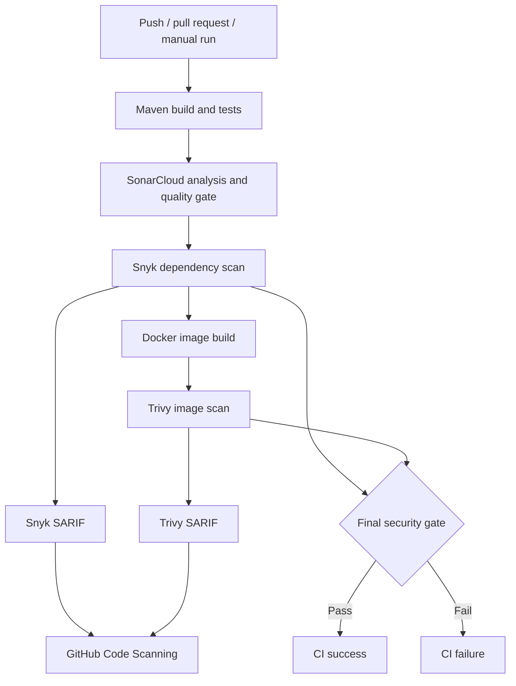

# 🚀 Lean DevSecOps CI/CD Pipeline

[](https://github.com/riyan-ahmed/lean-devsecops-pipeline/actions/workflows/main.yml)

**Shift-left application and container security using GitHub Actions, Maven, SonarCloud, Snyk, Trivy and Docker.**

A **University of Hertfordshire DevSecOps research implementation**, developed through my university research work in the Research Assistant – DevSecOps & Cloud Security context and connected to my MSc Advanced Computer Science studies. It investigates the trade-offs between vulnerability detection, CI/CD speed and security enforcement. The repository demonstrates **continuous integration and security scanning**, not deployment to a production environment.

[View the workflow](.github/workflows/main.yml) · [Successful end-to-end run, 10 August 2026](https://github.com/riyan-ahmed/lean-devsecops-pipeline/actions/runs/31427793541) · [Dockerfile](Dockerfile)

## What it does

- **Build and test:** Maven builds and tests the Java/Spring Boot application.
- **SAST and quality gate:** SonarCloud analyses code and evaluates its quality gate.
- **Dependency security:** Snyk scans application dependencies and generates JSON and SARIF reports.
- **Container security:** Trivy scans the Docker image for high and critical findings.
- **Security visibility:** Snyk and Trivy SARIF files are uploaded to **GitHub Code Scanning** under separate categories.
- **Security enforcement:** GitHub Actions evaluates Snyk and Trivy outcomes after report uploads and fails the job when a scan fails.
- **Image hardening:** A multi-stage Dockerfile uses a JRE runtime, non-root execution and a health check.

## Pipeline architecture



The implementation is **one GitHub Actions job with multiple steps**, rather than separate deployment pipelines.

## Tooling and reporting

| Area | Technology | Implementation |
| --- | --- | --- |
| CI | GitHub Actions | Push to `main`, pull requests to `main`, and manual runs |
| Build and tests | Maven, JUnit | `./mvnw -B clean verify` |
| Code analysis | SonarCloud | Static analysis and quality-gate wait |
| Dependency scan | Snyk | High-severity threshold; JSON and SARIF reports |
| Image scan | Trivy | HIGH/CRITICAL image scanning; SARIF report |
| Reporting | GitHub Code Scanning | SARIF uploads from **Snyk and Trivy** |
| Maintenance | Dependabot | Weekly Maven, Docker and Actions dependency checks |

**Reporting accuracy:** SonarCloud has its own reporting and quality gate. Only Snyk and Trivy are configured to upload SARIF in this repository. **OWASP ZAP is not part of the current workflow.**

### Security gate behaviour

The workflow uploads available Snyk and Trivy reports before checking their results. It fails if either scanner fails. SonarCloud is checked earlier, so a SonarCloud failure can stop subsequent standard steps.

Trivy has `ignore-unfixed: true` enabled, so vulnerabilities without available fixes are excluded from its blocking scan. Passing the workflow means its configured checks passed on that run; it is **not** a guarantee that no vulnerabilities exist.

## Vulnerability remediation

Dependency and container scans identified vulnerabilities during development. The project's recorded remediation examples include:

| Dependency family | Earlier version(s) | Patched version |
| --- | --- | --- |
| Spring Boot | 3.3.0 | 3.5.15 |
| Spring Framework | 6.1.8 | 6.2.19 |
| Logback | 1.5.6 / 1.5.34 | 1.5.36 |
| Jackson | 2.17.1 / 2.21.4 | 2.21.5 |
| Apache Tomcat | 10.1.24 / 10.1.55 | 10.1.56 |
| Micrometer | 1.13.0 | 1.15.12 |

These are **six dependency families**, not six separately deployed application components. Review [`pom.xml`](pom.xml) and the commit history for the source configuration.

The [10 August 2026 run](https://github.com/riyan-ahmed/lean-devsecops-pipeline/actions/runs/31427793541) successfully completed the build, tests, SonarCloud analysis, Snyk and Trivy scans, SARIF uploads and final security gate. Later Dependabot pull-request runs have experienced build compatibility and SonarCloud authorisation errors. A previously successful run should not be presented as proof that every future run succeeds.

## Container security

The [Dockerfile](Dockerfile) implements a multi-stage JDK build and JRE runtime image, executes the application as a non-root `spring` user and includes a Docker health check targeting the Spring Boot Actuator endpoint.

This repository demonstrates **one application Docker image**. It does not independently establish that four or more distinct images were hardened.

## Run locally

Prerequisites: Java 17+, Git and Docker.

Build and test:

```bash
./mvnw clean verify
```

Build and run the container:

```bash
docker build -t lean-devsecops-pipeline:local .
docker run --rm -p 8081:8080 lean-devsecops-pipeline:local
```

Check its health in another terminal:

```bash
curl http://localhost:8081/actuator/health
```

Expected healthy response:

```json
{"status":"UP"}
```

The full workflow requires GitHub Actions plus the configured SonarCloud and Snyk authentication secrets.

## Evidence and results

| Evidence | Location |
| --- | --- |
| CI history, step logs and scan artifacts | [GitHub Actions](https://github.com/riyan-ahmed/lean-devsecops-pipeline/actions/workflows/main.yml) |
| Verified successful run | [10 August 2026 workflow execution](https://github.com/riyan-ahmed/lean-devsecops-pipeline/actions/runs/31427793541) |
| Snyk and Trivy findings | [GitHub Code Scanning](https://github.com/riyan-ahmed/lean-devsecops-pipeline/security/code-scanning) |
| Dependency configuration | [`pom.xml`](pom.xml) |
| Container hardening | [`Dockerfile`](Dockerfile) |
| Responsible disclosure | [`SECURITY.md`](SECURITY.md) |

## Design decisions and limitations

- **Report before enforcing:** Preserve scan outputs even when scans return non-zero results.
- **Prioritise severe findings:** Security checks target high and critical vulnerabilities, not every lower-severity issue.
- **Maintain dependencies:** Dependabot proposes updates to Maven, Actions and Docker dependencies.
- **Avoid overstating scope:** This is a CI/security demonstration, without Kubernetes or AWS deployment, production uptime metrics or a DAST stage.
- **Treat scanning as continuous:** Findings change as dependencies and vulnerability databases are updated.

## Repository structure

```text
.github/
  workflows/main.yml
  dependabot.yml
src/main/
src/test/
Dockerfile
pom.xml
SECURITY.md
README.md
```

## University research context

This repository documents **DevSecOps and cloud security research work undertaken at the University of Hertfordshire** as part of my Research Assistant experience, and is connected with my MSc Advanced Computer Science final project:

**“An Analytical Case Study of Shift-Left Security: Evaluating the Practical Trade-Offs of Integrating Open-Source Security Tools into a Java CI/CD Pipeline.”**

The implementation explores shift-left scanning, vulnerability remediation, SARIF reporting and security enforcement in CI/CD. The repository provides technical evidence for the features documented here; wider Research Assistant responsibilities should be supported by their own evidence.

---

**Maintainer:** [Riyan Ahmed](https://github.com/riyan-ahmed) · [LinkedIn](https://www.linkedin.com/in/riyan-ahmed-devops/)
